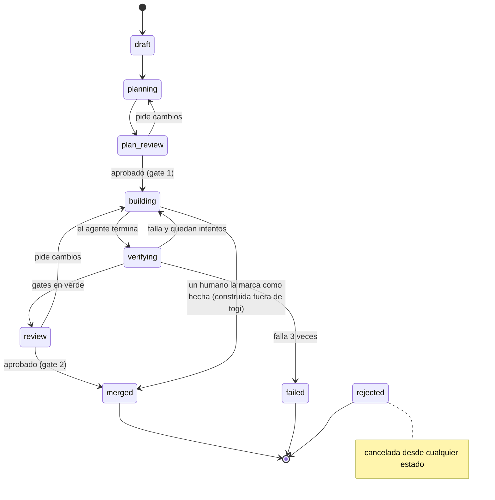

# ADR-001: Flujo de tareas de togi

2 de noviembre de 2026 · Arian

## Estado y contexto

**Estado:** aprobado el 10 de noviembre de 2026, junto con el ADR-011, que construye `building`, `verifying`, `review` y `failed`. La integración de `dev` cuando avanza y la merge queue pasan a la rebanada 4.

**Enmienda del 11 de noviembre de 2026: rehacer una tarea fallida.** `failed` sigue siendo final: la tarea no se reabre ni vuelve a `planning`, y su historial se queda tal cual para aprender de él. Como en una planta, la pieza defectuosa va a descarte y se fabrica otra:

- **Lo pide un humano, nunca togi solo.** Tres fallos casi siempre indican una tarea mal escrita, y repetirla sin cambios gasta sesiones en el mismo error. Solo se rehace una tarea `failed` cuyo fallo ya está clasificado (`failure.classified`, ADR-004), y cada una como mucho una vez: si la nueva también falla, se rehace la nueva.
- **togi crea una tarea nueva en `draft`, enlazada a la fallida.** Copia el título, la descripción, el criterio de aceptación, el riesgo, el repo y la rama base; el humano puede editarlos antes de enviarla. Pasa por el gate 1 como cualquier otra y tiene sus propios 3 ciclos.
- **El planificador de la nueva sabe qué salió mal.** Recibe como contexto los gates que fallaron en el último ciclo de la original y la clasificación del humano.

Cada tarea de togi recorre siete estados con dos gates humanos: la aprobación del plan y la revisión del PR. El objetivo es imponer el flujo que siguen los equipos que usan agentes con éxito (Stripe, Spotify, Dropbox, `dotnet/runtime`): tareas pequeñas, plan aprobado antes del código, verificación independiente del agente y PRs revisables.

La primera foto de la línea base de `promos` (61 PRs a `main` desde el 1 de octubre de 2026) muestra lo contrario:

- Lead time mediano de 0,2 h entre abrir y mergear: no hay revisión real.
- Tamaño mediano de 672 líneas por PR, con casos de 3.000 y 9.704.
- Solo el 23% de los PRs en un único commit; las correcciones van dentro del propio PR.

El valor de togi no es ir más rápido, sino producir cambios pequeños, verificados y revisables.

## Decisión: los estados de una tarea

Una tarea solo avanza cuando se cumple la condición de su estado. El agente actúa en dos estados, los gates de togi en uno y el humano en tres.

| # | Estado | Quién actúa | Qué ocurre | Condición para avanzar |
| --- | --- | --- | --- | --- |
| 1 | `draft` | Humano | Se escribe la tarea: qué cambiar, criterio de aceptación y área afectada. | Tiene criterio de aceptación y nivel de riesgo asignado. |
| 2 | `planning` | Agente | Lee el repo sin modificarlo y propone un plan: ficheros a tocar, enfoque, tests nuevos y tamaño estimado. | Plan entregado. |
| 3 | `plan_review` | Humano (gate 1) | Aprueba, pide cambios o rechaza. Si el plan supera el límite de tamaño, se parte la tarea. | Plan aprobado. |
| 4 | `building` | Agente | Trabaja en un workspace aislado y repite formato, tipos, lint y tests hasta que pasan. | El agente declara que ha terminado. |
| 5 | `verifying` | Gates de togi | Repite la verificación sin fiarse del agente y comprueba el contrato del plan. | Todos los gates en verde. |
| 6 | `review` | Humano o revisor delegado (gate 2) | Se abre un PR hacia `dev` con el diff y la evidencia de los gates. | Aprobado. |
| 7 | `merged` | togi | Merge a `dev`. | Estado final. |

Estados finales sin merge: `failed` (agotó los reintentos) y `rejected` (cancelada por el humano).

**`merged` tiene un segundo camino, manual.** Además del merge de togi desde `review`, `merged` se alcanza cuando un humano marca como hecha una tarea que construyó fuera de togi (`task.completed`, `togi task done`). Solo se admite desde `building`: la tarea ya tiene su plan aprobado y el humano hizo el trabajo y el PR por su cuenta. La marca la pone únicamente un humano (un agente o el sistema reciben `actor_not_allowed`) y es definitiva. El número del PR que acompaña a la marca es una referencia que da el humano: togi no tiene acceso a GitHub y no la verifica.

## Transiciones

El camino feliz va de `draft` a `merged`; las dos vueltas atrás (pedir cambios y fallar verificación) devuelven el trabajo al agente, nunca saltan un gate.

## Reglas del flujo

1. **El plan es un contrato.** En `verifying`, un diff que toca ficheros ausentes del plan aprobado falla el gate.
2. **Tests: añadir sí, modificar no.** El agente puede crear tests nuevos; los existentes son de solo lectura y no se pueden marcar como skip. Esto resuelve la tensión entre el principio 4 y la idea de usar agentes para reforzar la base de tests.
3. **Límite de 300 líneas de diff por tarea.** Cifra propia, no sale de la evidencia; se ajusta con los datos del piloto. Un plan que estime más se parte en `plan_review`.

   > **Nota (rebanada 2):** desde la rebanada 2, el límite del gate 1 sigue el ADR-007: 200 líneas de producción y 500 en total, con la estimación del plan separada en `{ production, tests }`. Sustituye a las 300 líneas de esta regla; `FlowPolicy.maxLines` pasa a `maxProductionLines` y `maxTotalLines`.
4. **Máximo de 3 ciclos `building` → `verifying`.** Al tercer fallo la tarea pasa a `failed` y vuelve al humano: casi siempre indica una tarea mal escrita o demasiado grande.

   > **Nota (11 de noviembre de 2026):** el humano puede rehacerla como una tarea nueva; ver la enmienda del estado.
5. **El agente no se autoevalúa.** Su bucle interno en `building` es una ayuda; la única verificación que cuenta es la de `verifying`, ejecutada por togi en un entorno que el agente no controla.
6. **Todo es un evento.** Cada cambio de estado, acción del agente, resultado de gate y decisión humana se registra en un log append-only. El estado de la tarea es una proyección de ese log.
7. **Atribución.** Todo commit del agente lleva el trailer `Assisted-by: <agente>/<modelo>`.

## Riesgo y política de gates

El gate 1 (plan) es siempre humano: es el único punto donde se comprueba que la tarea es lo que se quería. El gate 2 (revisión) se delega por nivel de riesgo, de forma progresiva.

| Nivel | Áreas en `promos` | Gate 1 | Gate 2 al inicio | Gate 2 objetivo |
| --- | --- | --- | --- | --- |
| Bajo | UI, docs, colecciones de Bruno | Humano | Humano | Gates + revisor delegado; auto-merge |
| Medio | Lógica de la API | Humano | Humano | Revisor delegado primero; humano revisa lo que marca más una muestra |
| Alto | Perfiles de acceso, migraciones, envío de emails, compras | Humano | Humano | Humano, siempre |

Criterio para delegar un nivel: el revisor delegado, en modo sombra, coincide con el humano en 20 tareas seguidas de ese nivel sin desacuerdos graves ni bugs escapados. Es una cifra propia, a revisar con los datos del piloto.

El revisor delegado debe ser independiente del agente que escribió el código (otro modelo, o al menos otro contexto), para no compartir sus puntos ciegos.

El nivel de riesgo se asigna en `draft` y se recalcula en `verifying` según los ficheros tocados: si el diff alcanza un área de nivel superior, la tarea sube de nivel.

## Alternativas descartadas

| Alternativa | Por qué se descarta |
| --- | --- |
| Sin plan: de la tarea directamente al código | Revisar un plan lleva minutos; revisar un diff grande basado en un malentendido lleva horas. Es justo el patrón actual de `promos`. |
| Sin humano en ningún gate ("dark factory") | En `dotnet/runtime`, los PRs totalmente autónomos se fusionaron el 55,1% frente al 86,2% con commits humanos; según METR, la mitad de los PRs que pasaban los tests no se habrían aceptado. Solo lo sostienen equipos con verificación muy madura. |
| Auto-merge del riesgo bajo desde el inicio | Aún no hay datos de que los gates aguanten (principio 1). Se activa con el criterio de delegación. |
| Tests ocultos al agente | Reduce las trampas casi a cero pero también el éxito legítimo (ImpossibleBench). Los tests de solo lectura bloquean las ediciones sin ese coste. |
| Confiar en la verificación del propio agente | Los agentes hackean el verificador cuando la tarea es difícil; por eso `verifying` la repite togi de forma independiente. |

Trade-off asumido: cada tarea exige escribir un criterio de aceptación y aprobar un plan, más trabajo por tarea que el flujo actual a cambio de PRs pequeños y revisables.

## Consecuencias y cuestiones resueltas

El modelo de datos (paso 4) sale de este flujo. Como mínimo necesita:

- **Tarea:** descripción, criterio de aceptación, nivel de riesgo, estado actual (proyección del log).
- **Plan:** ficheros previstos, enfoque, tests nuevos, tamaño estimado; versionado, porque se puede pedir cambios.
- **Sesión de agente:** una por `planning` y por cada ciclo de `building`.
- **Workspace:** aislado por tarea.
- **Ejecución de gate:** gate, resultado y evidencia, una por ciclo de `verifying`.
- **Decisión humana o delegada:** quién, en qué gate, veredicto y motivo.
- **Evento:** el registro append-only del que se derivan todos los anteriores.

Cuestiones abiertas, resueltas el 2 de noviembre de 2026:

- **Origen de las tareas.** La tarea existe una sola vez, en togi. CLI, GitHub Issues, Jira, Sentry y la conversación con el agente son adaptadores que crean una tarea en `draft` con la referencia a su origen, y togi devuelve allí el estado. Ninguna fuente se salta el gate 1, y el texto de fuentes externas se trata como entrada no fiable. MVP: CLI y GitHub Issues.
- **Dónde vive el plan.** La fuente de verdad es togi, versionada en el log de eventos; el gate solo usa esa versión. La descripción del PR lleva una copia marcada como copia, con la versión del plan. Todo agente que lea la copia recibe la instrucción explícita de consultar el plan en togi ante cualquier duda o discrepancia.
- **Cuando `dev` avanza.** Quien revisa no modifica la rama. togi integra `dev` en la rama de la tarea: si el merge es limpio, repite `verifying`; la aprobación se mantiene si los cambios de `dev` no tocan los ficheros de la tarea y vuelve a `review` si los tocan. Si hay conflicto, la tarea vuelve a `building`. togi serializa los merges, porque la merge queue nativa de GitHub probablemente no está disponible en un repo privado de cuenta personal (pendiente de confirmar).
